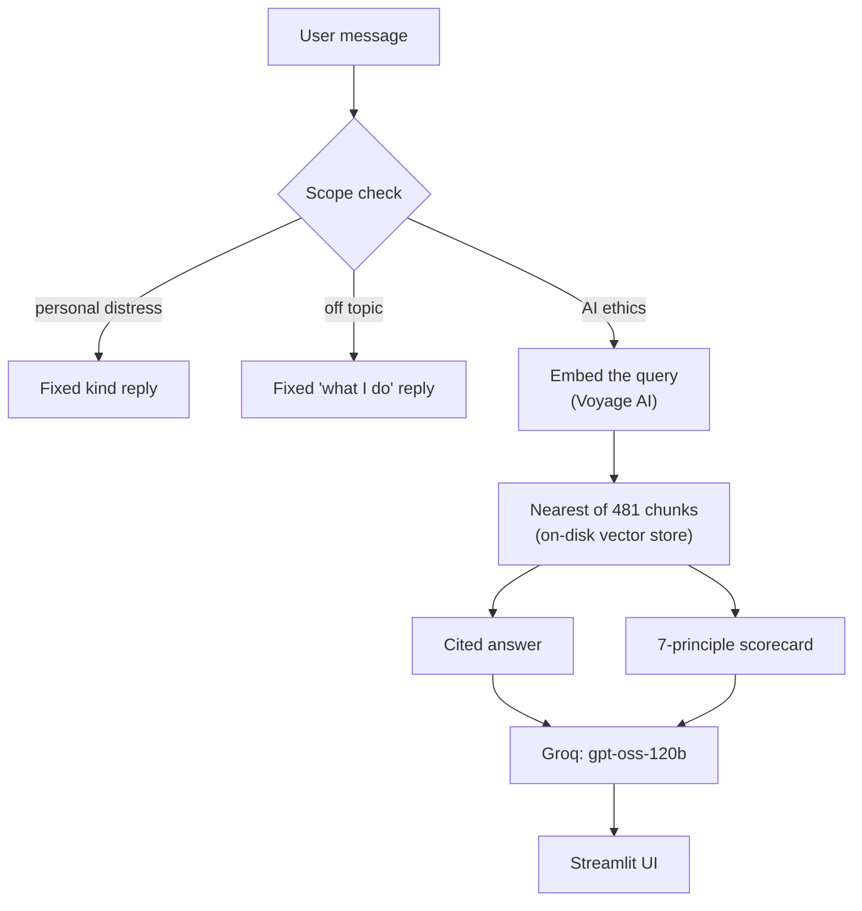
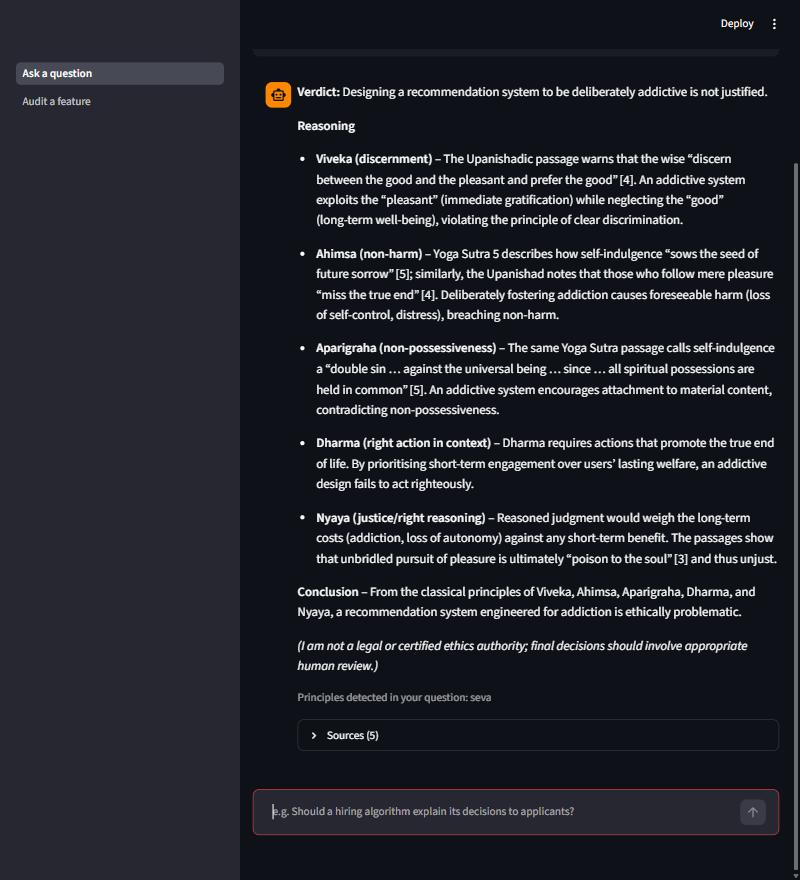
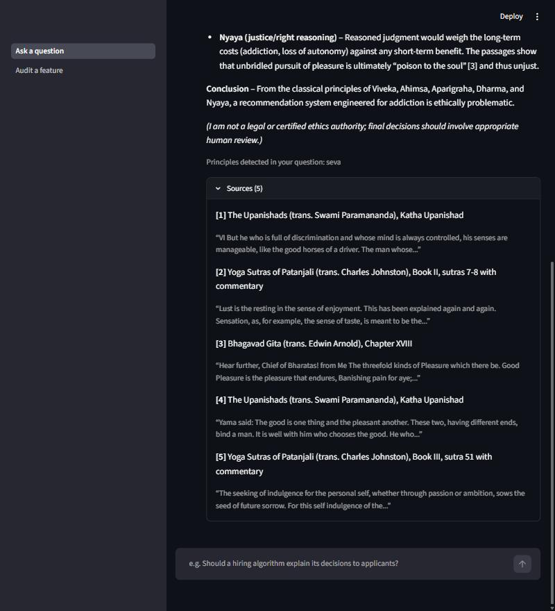
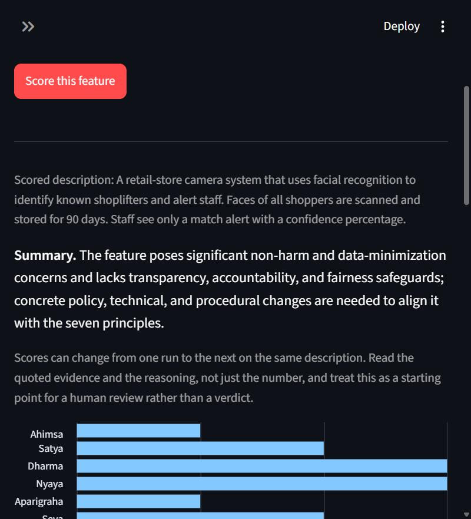
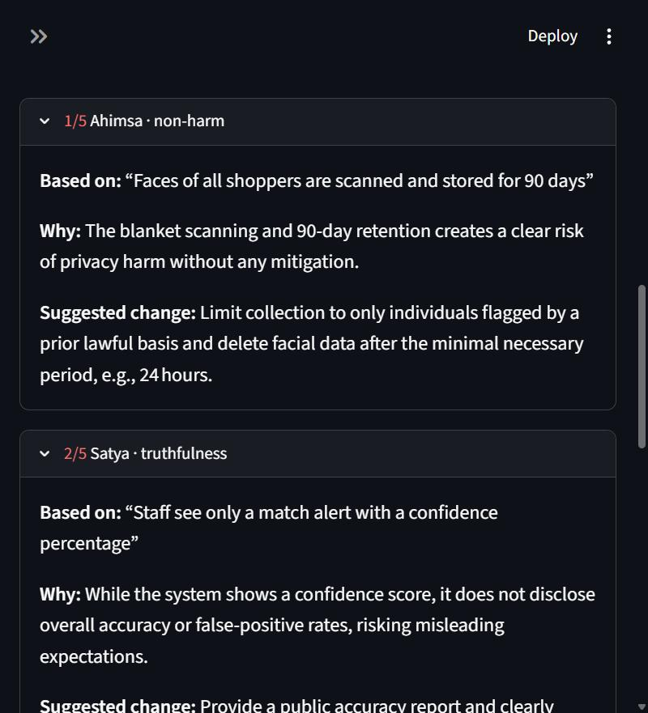
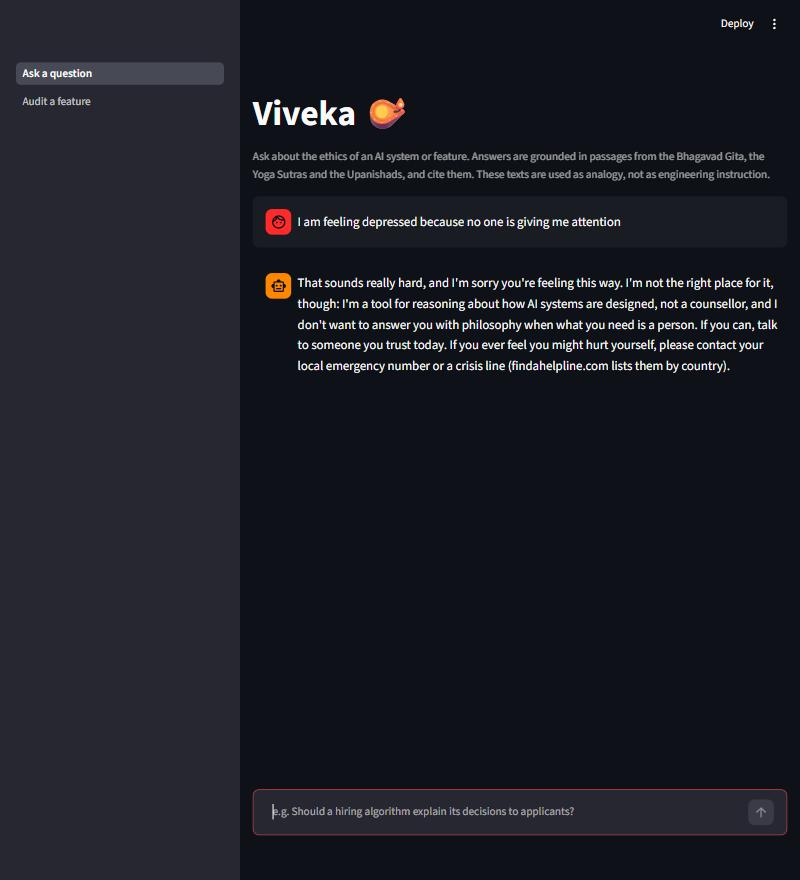

# Viveka (विवेक)

[](https://github.com/23f1000642/viveka/actions/workflows/tests.yml)

An AI ethics advisor built on a retrieval corpus of classical Indian philosophy — the Bhagavad Gita, the Yoga Sutras, three Upanishads (Isa, Katha, Kena) and five justice-related chapters of Kautilya's Arthashastra — reasoning about modern AI harm, transparency, and fairness through categories that predate the field by two thousand years.

## Why this project

Seven categories from classical Indian ethics map cleanly onto seven live problems in AI system design:

| Classical principle | Maps to |
|---|---|
| Ahimsa (अहिंसा) — non-harm | Non-maleficence / harm reduction |
| Satya (सत्य) — truthfulness | Transparency & honest capability claims |
| Dharma (धर्म) — right action in context | Accountability & context-aware duty |
| Nyaya (न्याय) — justice, right reasoning | Fairness & due process |
| Aparigraha (अपरिग्रह) — non-possessiveness | Data minimization |
| Seva (सेवा) — selfless service | Human-centered design |
| Viveka (विवेक) — discernment | Human oversight & the limits of automation |

Full mapping with citations lives in [`docs/MAPPING.md`](docs/MAPPING.md).

## Architecture



A message is first sorted by a scope check, so someone describing their own
distress gets a fixed, reviewed reply instead of an AI-ethics answer. Everything
else is embedded, matched against passages from the corpus, and answered or scored
from those passages with citations. The full flow, the offline pipeline that builds
the index, and the reasoning behind each decision are in
[`docs/ARCHITECTURE.md`](docs/ARCHITECTURE.md).

Two of those decisions came from a locked-down Windows machine rather than from
design preference: embeddings are a hosted API call (a local model's scikit-learn
DLL was blocked by an Application Control policy), and the vector index is a small
standard-library store (ChromaDB's gRPC DLL was blocked later). Generation runs on
Groq's free tier rather than the Claude API, since a fresh Anthropic key ships with
no free credits; `src/rag/llm.py` is the one place that names the provider. See
`docs/LOG.md` (Days 8, 10 and 19) for the stories.

## What it looks like

Screenshots of the running app. The model's wording and the scores vary from
run to run.

**Ask a question.** A cited answer: a verdict, the principles it applies, and
numbered references into the texts.



Each reference opens to the translator, a location a reader can look up
(chapter, Upanishad, or sutra), and the quoted passage.



**Audit a feature.** Describe an AI feature and get a 1-5 score on each of the
seven principles. Every score quotes the words of the description it rests on.





**Messages that aren't about AI ethics** (for example someone describing their
own distress) are not sent to the advisor. They get a fixed, kind reply that
points to a person and a crisis-line directory.



## Status
Till now i have reached at  the full RAG pipeline works end-to-end: retrieval,
grounded generation, and cited answers.

🚧 Week 3 nearly done — the Ethics Scorecard (7 principles, evidence-quoted
and validated), a 19-case evaluation set with results and a changelog, and a
scope guard that routes non-AI-ethics messages (including someone describing
their own distress) to a fixed, kind reply instead of the advisor. Next: the
Streamlit UI. Daily log in [`docs/LOG.md`](docs/LOG.md).


wait for UI deoplyment part will back soon 

## Setup

```bash
python -m venv .venv
.venv\Scripts\activate      # Windows
pip install -r requirements.txt
cp .env.example .env        # then fill in VOYAGE_API_KEY and GROQ_API_KEY
python src/data_prep/clean.py
python src/data_prep/chunk.py
python src/rag/index.py     # only if you changed the chunks: re-embeds them (~8 min on the free tier).
                            # The built index (data/index/, 1.4 MB) is already committed.
streamlit run app.py
python -m pytest tests      # headless UI tests and error-mapping tests, no network needed
```

## Deploying

The app is meant for Streamlit Community Cloud's free tier. New app, repository
`23f1000642/viveka`, branch `main`, main file `app.py`, Python 3.12. Under
**Advanced settings → Secrets**, paste (top-level keys; Streamlit exposes them to
the app as environment variables, which is what the code reads):

```toml
VOYAGE_API_KEY = "your-voyage-key"
GROQ_API_KEY = "your-groq-key"
```

The search index (`data/index/`, 1.5 MB) is committed, so a deployed copy needs
no embedding step.

**Limits of a live demo on free tiers.** Each question costs one Voyage embedding
call and two Groq calls (a scope check, then the answer); an audit costs one Voyage
call and two or three Groq calls. A free Voyage account without a payment method
allows 3 requests per minute across *all* visitors, so a few people asking at once
will hit it. When a limit is hit the app shows a short "busy, try again in a minute"
message instead of an error.

## License

MIT — see [LICENSE](LICENSE).
