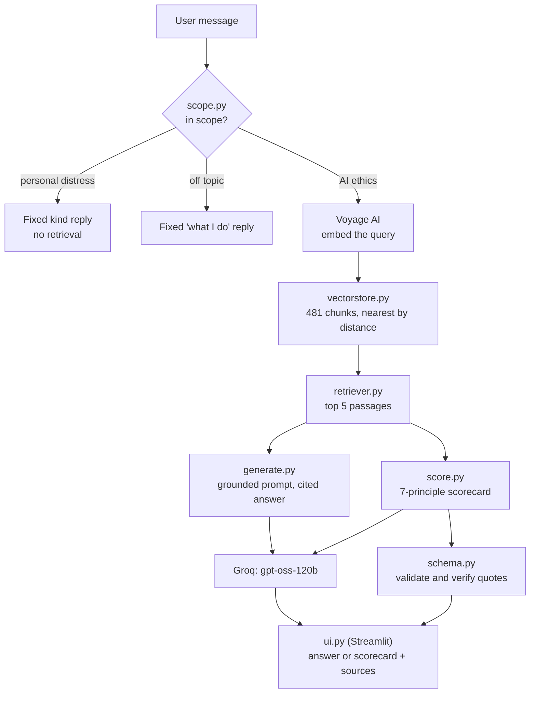
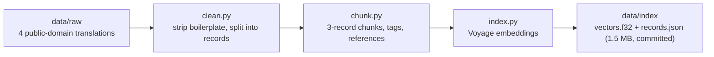

# Architecture

How a question becomes a cited answer, how the text got there, and why the
pieces are the way they are. Each decision points at the day in
[`LOG.md`](LOG.md) where the evidence is.

## At request time

Every external call goes through `errors.py`, which turns a rate limit, a timeout
or a missing key into one plain sentence for the user and logs the real error.

## How the text gets there (offline)

| Text | Translator | In the corpus |
|---|---|---|
| Bhagavad Gita | Edwin Arnold, 1885 | whole text |
| Yoga Sutras | Charles Johnston, 1912 | whole text |
| Upanishads | Swami Paramananda, 1919 | Isa, Katha, Kena |
| Arthashastra | R. Shamasastry, 1915 | five justice-related chapters |

## Where things live

| Path | What it does |
|---|---|
| `app.py`, `ui.py` | Streamlit router and the two pages (Ask, Audit) |
| `src/rag/scope.py` | Sorts each message into in scope / personal distress / off topic before anything else runs |
| `src/rag/retriever.py`, `vectorstore.py`, `embeddings.py` | Query embedding, the on-disk vector store, nearest-passage search |
| `src/rag/prompts.py`, `generate.py`, `llm.py` | The grounded prompt, the answer call, and the one place that names the model and URL |
| `src/scorecard/schema.py`, `score.py` | The scorecard contract and the retrying generator |
| `src/rag/errors.py` | Failure to message mapping |
| `src/data_prep/` | `clean.py`, `chunk.py` |
| `src/eval/`, `data/eval/` | The scorecard eval, the scope eval, the retrieval check, and their cases |
| `tests/` | 43 offline tests; CI runs them on every push (Python 3.12 and 3.13) |

## Decisions and the reasons for them

- **Hosted embeddings, not a local model** (Day 8). A local `sentence-transformers`
  install pulled in scikit-learn, whose compiled DLL a Windows Application Control
  policy on the development machine blocked. The fix was to change the design, not
  the machine's security settings.
- **A standard-library vector store, not ChromaDB** (Day 19). The same policy later
  blocked ChromaDB's gRPC dependency. For 481 vectors a database was overkill
  anyway: one float32 file, one JSON file, and a scan. It returns the same squared-L2
  distance ChromaDB did; four of the five Day 8 test queries came back with the same
  chunk and the same distances to three decimals (the fifth had changed for an
  unrelated, earlier keyword fix).
- **The model provider is isolated in `llm.py`** (Day 10, Day 18). Swapping Anthropic
  for Groq's free tier touched one function.
- **Scope check first, fixed replies for distress** (Day 18). An early version
  answered a message about feeling ignored with a verse-backed ethics reply that
  called it "attention-seeking". Someone struggling gets a reviewed message, not
  whatever a model writes that day, and the check runs before retrieval so it also
  saves a rate-limited API call.
- **Evidence-first scorecard** (Day 17). Every score must quote the description,
  and the code checks the quote is really there. It made scores auditable. It did
  not improve accuracy: recall and precision against my own labels barely moved.
- **Chunks never cross a book or a chapter, and references come from real
  structure** (Day 21, Day 26). Citations read "Katha Upanishad" or "Book II,
  sutras 7-8", never an internal paragraph counter.
- **The principle-tag boost defaults to off** (Day 26). It was built on Day 8 to
  compensate for weak raw similarity. Once the Arthashastra was added, a small
  check showed it pushed that source out of justice results. Kept in the code for
  experiments.
- **Every citation in `MAPPING.md` marked "in the corpus" matches the raw files
  verbatim** (Day 24), and the ones that are not in the corpus say so.

## Known limits

- The free tiers are the bottleneck: Voyage allows 3 requests a minute without a
  payment method, shared by every visitor.
- The scorecard varies run to run on the same input. Variance has not been
  measured properly (3 runs per case); that is the first thing to do before any
  further prompt change.
- The eval labels (`expected_low`, the retrieval-check queries) are the author's own.
- The scorecard eval was last run before the Arthashastra was added and before the
  boost was turned off.
- Gita and Upanishad citations stop at chapter or Upanishad level: the translations
  used carry no verse numbers that survived cleaning.
- Chunk principle tags are keyword matches and noisy.
- The "right reasoning" sense of Nyaya (the logic school) has no source text.
